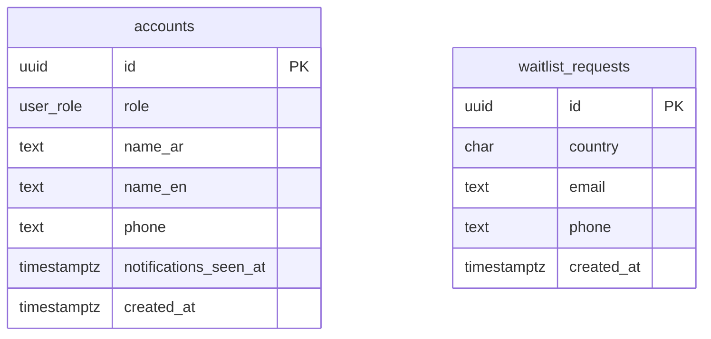
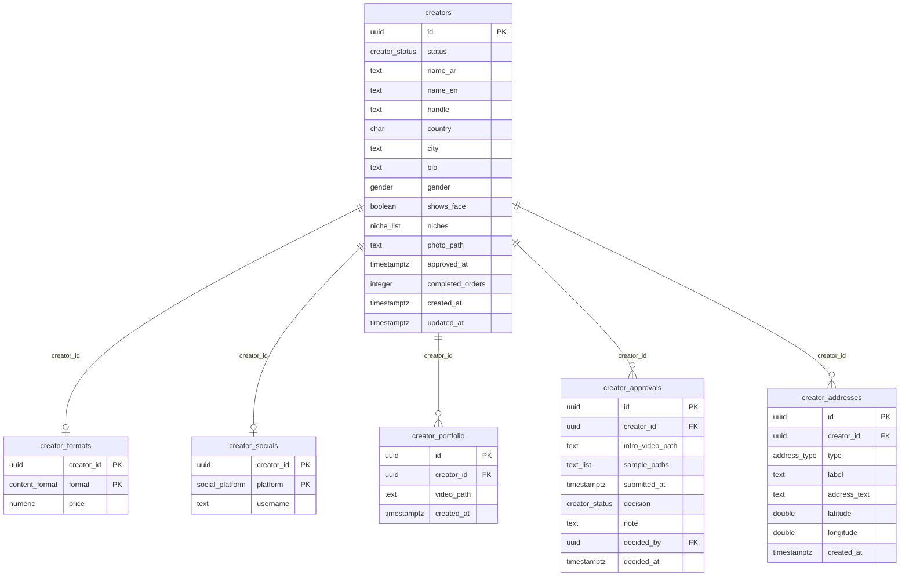
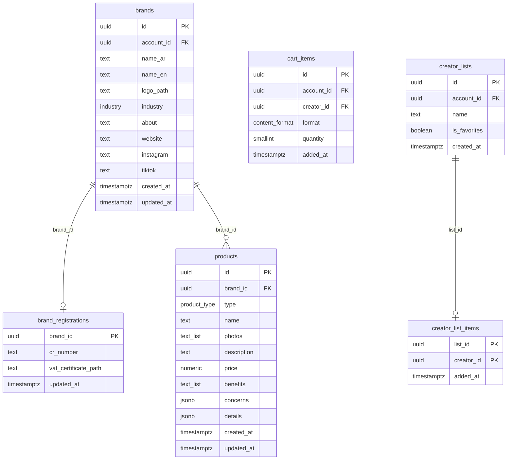
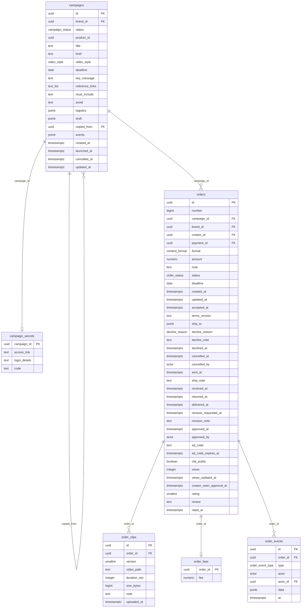
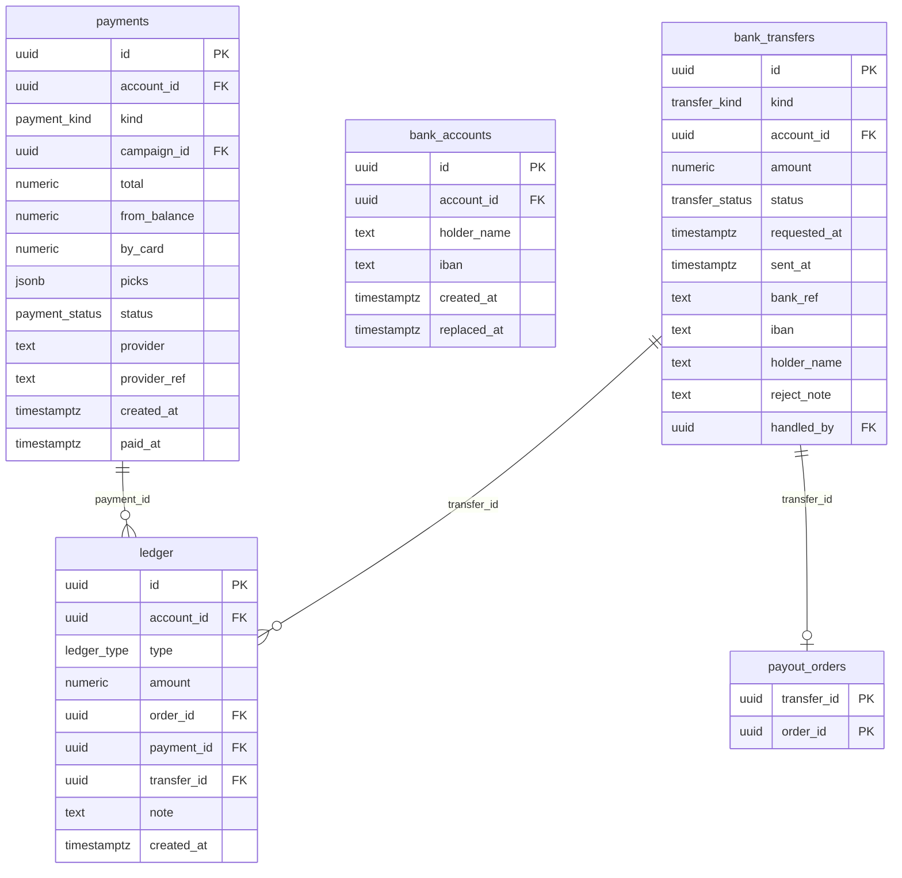
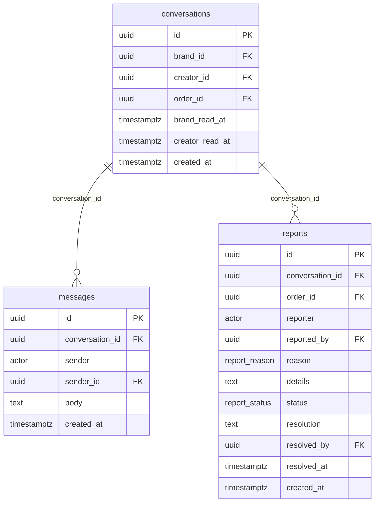
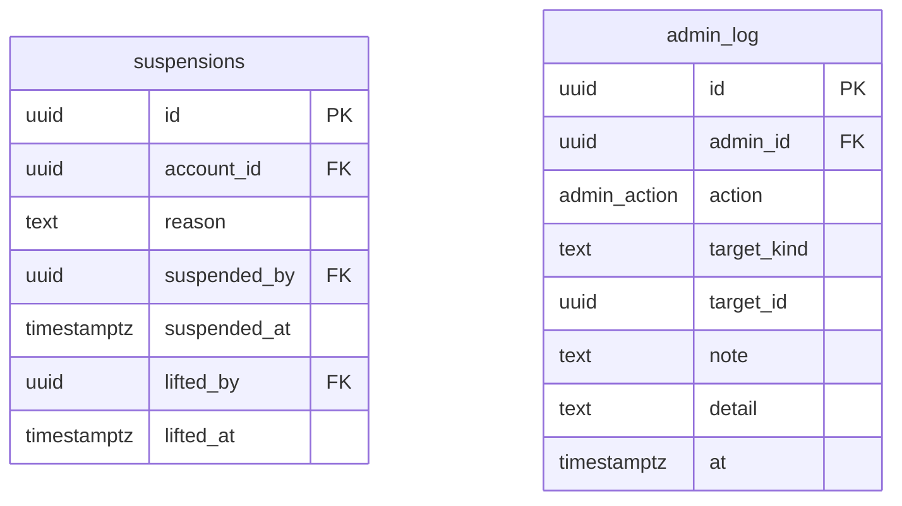

# 100clips database (schema v2)

Generated from `supabase/migrations/20261010120000_initial_schema.sql`. 30 tables, 23 enums.
GitHub and VS Code show these diagrams; dbdiagram.io reads `schema.dbml`.

## How the pieces fit

- **One order = one video.** A brand pays for a campaign; each creator gets an order. The fee sits in `order_fees`, which creators can't read.
- **Nobody writes orders or money directly.** The apps call database functions (`accept_offer`, `approve_order`, `checkout`...) that check the caller and the order's state, then write `order_events` and `ledger` rows.
- **Balances are sums of `ledger`.** Brand balance per account, creator balance per creator.
- **Scheduled jobs:** offers expire after 96 hours (refund), clips auto-approve after 7 days, "deadline passed" notices.

## Overview

```mermaid
erDiagram
  accounts {
    uuid id PK
  }
  waitlist_requests {
    uuid id PK
  }
  creators {
    uuid id PK
  }
  creator_formats {
    uuid creator_id PK
    content_format format PK
  }
  creator_socials {
    uuid creator_id PK
    social_platform platform PK
  }
  creator_portfolio {
    uuid id PK
    uuid creator_id FK
  }
  creator_addresses {
    uuid id PK
    uuid creator_id FK
  }
  creator_approvals {
    uuid id PK
    uuid creator_id FK
    uuid decided_by FK
  }
  brands {
    uuid id PK
    uuid account_id FK
  }
  brand_registrations {
    uuid brand_id PK
  }
  products {
    uuid id PK
    uuid brand_id FK
  }
  cart_items {
    uuid id PK
    uuid account_id FK
    uuid creator_id FK
  }
  creator_lists {
    uuid id PK
    uuid account_id FK
  }
  creator_list_items {
    uuid list_id PK
    uuid creator_id PK
  }
  campaigns {
    uuid id PK
    uuid brand_id FK
    uuid copied_from FK
  }
  campaign_secrets {
    uuid campaign_id PK
  }
  payments {
    uuid id PK
    uuid account_id FK
    uuid campaign_id FK
  }
  orders {
    uuid id PK
    uuid campaign_id FK
    uuid brand_id FK
    uuid creator_id FK
    uuid payment_id FK
  }
  order_clips {
    uuid id PK
    uuid order_id FK
  }
  order_fees {
    uuid order_id PK
  }
  order_events {
    uuid id PK
    uuid order_id FK
    uuid actor_id FK
  }
  bank_accounts {
    uuid id PK
    uuid account_id FK
  }
  bank_transfers {
    uuid id PK
    uuid account_id FK
    uuid handled_by FK
  }
  payout_orders {
    uuid transfer_id PK
    uuid order_id PK
  }
  ledger {
    uuid id PK
    uuid account_id FK
    uuid order_id FK
    uuid payment_id FK
    uuid transfer_id FK
  }
  conversations {
    uuid id PK
    uuid brand_id FK
    uuid creator_id FK
    uuid order_id FK
  }
  messages {
    uuid id PK
    uuid conversation_id FK
    uuid sender_id FK
  }
  reports {
    uuid id PK
    uuid conversation_id FK
    uuid order_id FK
    uuid reported_by FK
    uuid resolved_by FK
  }
  suspensions {
    uuid id PK
    uuid account_id FK
    uuid suspended_by FK
    uuid lifted_by FK
  }
  admin_log {
    uuid id PK
    uuid admin_id FK
  }
  accounts ||--o| creators : "id"
  creators ||--o| creator_formats : "creator_id"
  creators ||--o| creator_socials : "creator_id"
  creators ||--o{ creator_portfolio : "creator_id"
  creators ||--o{ creator_addresses : "creator_id"
  creators ||--o{ creator_approvals : "creator_id"
  accounts ||--o{ creator_approvals : "decided_by"
  accounts ||--o{ brands : "account_id"
  brands ||--o| brand_registrations : "brand_id"
  brands ||--o{ products : "brand_id"
  accounts ||--o{ cart_items : "account_id"
  creators ||--o{ cart_items : "creator_id"
  accounts ||--o{ creator_lists : "account_id"
  creator_lists ||--o| creator_list_items : "list_id"
  creators ||--o| creator_list_items : "creator_id"
  brands ||--o{ campaigns : "brand_id"
  campaigns ||--o{ campaigns : "copied_from"
  campaigns ||--o| campaign_secrets : "campaign_id"
  accounts ||--o{ payments : "account_id"
  campaigns ||--o{ payments : "campaign_id"
  campaigns ||--o{ orders : "campaign_id"
  brands ||--o{ orders : "brand_id"
  creators ||--o{ orders : "creator_id"
  payments ||--o{ orders : "payment_id"
  orders ||--o{ order_clips : "order_id"
  orders ||--o| order_fees : "order_id"
  orders ||--o{ order_events : "order_id"
  accounts ||--o{ order_events : "actor_id"
  accounts ||--o{ bank_accounts : "account_id"
  accounts ||--o{ bank_transfers : "account_id"
  accounts ||--o{ bank_transfers : "handled_by"
  bank_transfers ||--o| payout_orders : "transfer_id"
  orders ||--o| payout_orders : "order_id"
  accounts ||--o{ ledger : "account_id"
  orders ||--o{ ledger : "order_id"
  payments ||--o{ ledger : "payment_id"
  bank_transfers ||--o{ ledger : "transfer_id"
  brands ||--o{ conversations : "brand_id"
  creators ||--o{ conversations : "creator_id"
  orders ||--o{ conversations : "order_id"
  conversations ||--o{ messages : "conversation_id"
  accounts ||--o{ messages : "sender_id"
  conversations ||--o{ reports : "conversation_id"
  orders ||--o{ reports : "order_id"
  accounts ||--o{ reports : "reported_by"
  accounts ||--o{ reports : "resolved_by"
  accounts ||--o{ suspensions : "account_id"
  accounts ||--o{ suspensions : "suspended_by"
  accounts ||--o{ suspensions : "lifted_by"
  accounts ||--o{ admin_log : "admin_id"
```

## People

Who signs in, and who is waiting for their country.

## Creators

A creator's profile, application and private details.

## Brands

Brand accounts, their brands and products, and how they shortlist creators.

## Campaigns and orders

A brief sent to creators, one order (one video) per creator.

## Money

Card payments, the ledger behind every balance, and bank transfers out (brand withdrawals, creator payouts).

## Chat and support

Brand-creator chats, creator support chats, and reports on chats and orders.

## Admin

Suspensions and the log of everything admins do.

## Enums

| Enum | Values |
|---|---|
| `user_role` | creator, brand, admin |
| `actor` | creator, brand, admin, system |
| `niche` | general, beauty, food, fashion, family, fitness, travel, tech, gaming |
| `gender` | female, male |
| `content_format` | tiktok_video, instagram_reel, instagram_story |
| `social_platform` | instagram, tiktok |
| `address_type` | home, work |
| `creator_status` | incomplete, pending, changes_requested, rejected, approved |
| `industry` | food_beverage, fashion, tech, real_estate, automotive, health, education, home_living, other |
| `product_type` | physical, app, service, venue |
| `video_style` | ad, review, routine, unboxing, howto, other |
| `campaign_status` | draft, live, cancelled |
| `order_status` | pending, in_progress, delivered, approved, declined, cancelled |
| `decline_reason` | busy, not_my_niche, other, expired |
| `order_event_type` | offered, accepted, declined, expired, cancelled, sent, received, uploaded, revision_requested, approved, returned, ad_code_added, deadline_moved, deadline_passed |
| `payment_kind` | checkout, top_up |
| `payment_status` | pending, paid, failed |
| `ledger_type` | top_up, card_payment, charge, refund, earning, payout, withdrawal, withdrawal_returned, adjustment |
| `transfer_kind` | withdrawal, payout |
| `transfer_status` | requested, sent, rejected |
| `report_reason` | off_platform, abuse, spam, not_delivered, not_as_agreed, product_issue, creator_conduct, brand_conduct, payment, other |
| `report_status` | open, resolved |
| `admin_action` | creator_approved, changes_requested, creator_rejected, suspended, unsuspended, login_reset, deadline_extended, order_cancelled, payout_sent, withdrawal_sent, withdrawal_rejected, report_resolved |
